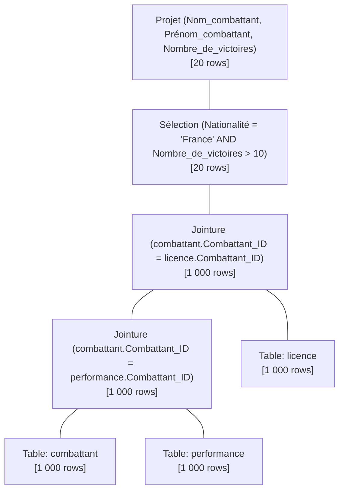
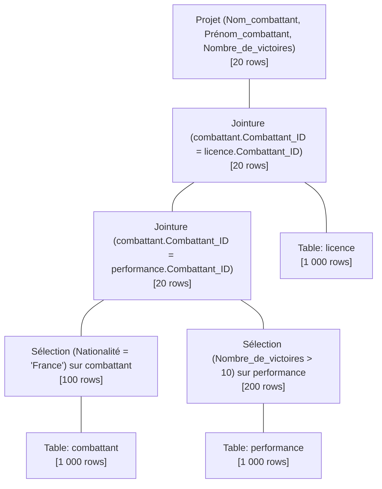

# Mini-Projet Bases de Données 1 (Partie 2) : Gestion d'une Organisation d'Événements de MMA


**Binôme :** Ayoub El Azzouzi *  Chraf Eddine Guidouche

---

## 1. Contexte du Projet

Ce projet a pour objectif de concevoir et développer une base de données relationnelle complète pour la gestion d'une organisation d'événements sportifs de MMA. Le système gère les combattants, leurs licences et performances, les combats, les arbitres, la billetterie et spectateurs, les partenaires médias ainsi que le sponsoring financier des événements.

---

## 2. Modèle Logique de Données (MLD)

Le MLD a été déduit du MCD élaboré dans la Partie 1 en appliquant les règles de transformation MERISE. 

*Conventions respectées :* Les clés primaires (PK) sont <u>soulignées</u> et les clés étrangères (FK) sont précédées du symbole **`#`**.

* **organisation** (<u>ID_organisation</u>, Nom_organisation, Email_organisation)
* **arbitre** (<u>ID_arbitre</u>, Nom_arbitre, Prénom_arbitre, Nationalité)
* **combattant** (<u>Combattant_ID</u>, Prénom_combattant, Nom_combattant, Date_de_naissance, Nationalité, Catégorie_de_poids, Statut_médical, Dernier_certificat_médical)
* **licence** (<u>Numéro_Licence_Sportive</u>, Date_délivrance, Date_expiration, #ID_organisation, #Combattant_ID)
* **performance** (<u>ID_performance</u>, Nombre_de_victoires, Nombre_de_défaites, Nombre_de_matchs_nuls, Nombre_de_victoires_par_ko, Nombre_de_victoires_par_soumission, #Combattant_ID)
* **media** (<u>ID_media</u>, Nom_media, Type_media)
* **combat** (<u>ID_combat</u>, Résultat_combat, Durée_combat, Poids_autorisé, #ID_arbitre)
* **évènement** (<u>ID_évènement</u>, Nom_évènement, Date_évènement, Lieu_évènement, #ID_media, #ID_combat, #ID_organisation)
* **spectateur** (<u>Téléphone_spectateur</u>, Nom_spectateur, Prénom_spectateur, Email_spectateur)
* **billet** (<u>ID_billet</u>, Catégorie_billet, Prix_billet, #ID_évènement, #Téléphone_spectateur, #ID_organisation)
* **sponsor** (<u>ID_Sponsor</u>, Nom_sponsor, Type_de_sponsoring, Montant_sponsoring, Début_contrat_sponsor, Fin_contrat_sponsor)
* **participe** (<u>#Combattant_ID</u>, <u>#ID_combat</u>)
* **est_obligatoire** (<u>#Numéro_Licence_Sportive</u>, <u>#ID_combat</u>)
* **finance** (<u>#ID_évènement</u>, <u>#ID_Sponsor</u>)

---

## 3. Modèle Physique de Données (MPD)

Le MPD est implémenté en SQL dans la base `mma_event_db`.

### 3.1 Tableau de récapitulation des tables et contraintes d'intégrité

| Nom de la Table | Clé Primaire (PK - <u>Soulignée</u>) | Clés Étrangères (FK - Précédées de `#`) | Intégrité Référentielle (ON DELETE / UPDATE) |
| :--- | :--- | :--- | :--- |
| **organisation** | <u>ID_organisation</u> | Aucune | - |
| **arbitre** | <u>ID_arbitre</u> | Aucune | - |
| **combattant** | <u>Combattant_ID</u> | Aucune | - |
| **licence** | <u>Numéro_Licence_Sportive</u> | #ID_organisation, #Combattant_ID | CASCADE / CASCADE |
| **performance** | <u>ID_performance</u> | #Combattant_ID | CASCADE / CASCADE |
| **media** | <u>ID_media</u> | Aucune | - |
| **combat** | <u>ID_combat</u> | #ID_arbitre | SET NULL / CASCADE |
| **évènement** | <u>ID_évènement</u> | #ID_media, #ID_combat, #ID_organisation | SET NULL / CASCADE |
| **spectateur** | <u>Téléphone_spectateur</u> | Aucune | - |
| **billet** | <u>ID_billet</u> | #ID_évènement, #Téléphone_spectateur, #ID_organisation | CASCADE / SET NULL |
| **sponsor** | <u>ID_Sponsor</u> | Aucune | - |
| **participe** | <u>#Combattant_ID</u>, <u>#ID_combat</u> | #Combattant_ID, #ID_combat | CASCADE / CASCADE |
| **est_obligatoire** | <u>#Numéro_Licence_Sportive</u>, <u>#ID_combat</u> | #Numéro_Licence_Sportive, #ID_combat | CASCADE / CASCADE |
| **finance** | <u>#ID_évènement</u>, <u>#ID_Sponsor</u> | #ID_évènement, #ID_Sponsor | CASCADE / CASCADE |

### 3.2 Fichiers SQL associés
- `1_creation.sql` : Script DDL de création du schéma et des 14 tables avec clés primaires, étrangères et règles d'intégrité.
- `2_contraintes.sql` : Script d'ajout des contraintes de validation métiers (`CHECK` sur le statut médical, le prix des billets, la cohérence des dates, etc.).
- `3_insertion.sql` : Script d'insertion du jeu de données réalistes généré automatiquement par IA générative.
- `4_interrogation.sql` : Script comportant 20 requêtes d'exploitation SQL.

---

## 4. Scénario d'Utilisation de la Base de Données

Le système d'information est conçu pour être utilisé principalement par deux rôles opérationnels au sein de l'organisation :

1. **Le Directeur Sportif :** Il exploite la base pour analyser les performances des combattants, vérifier la validité de leur statut médical et de leur licence sportive, programmer des affrontements équilibrés en fonction des catégories de poids et désigner des arbitres certifiés.
2. **Le Responsable Financier et Marketing :** Il suit le taux de remplissage et les revenus générés par la vente des billets par événement, évalue le rendement des partenariats conclus avec les sponsors et prépare les droits de diffusion télévisuelle et streaming avec les médias.

---

## 5. Étude d'Optimisation d'une Requête (Algèbre Relationnelle)

### Requête analysée (Q20 dans `4_interrogation.sql`)
Recherche des nom, prénom et nombre de victoires des combattants de nationalité française possédant plus de 10 victoires et disposant d'une licence sportive enregistrée.

```sql
SELECT c.Nom_combattant, c.Prénom_combattant, p.Nombre_de_victoires 
FROM combattant c 
JOIN performance p ON c.Combattant_ID = p.Combattant_ID 
JOIN licence l ON c.Combattant_ID = l.Combattant_ID 
WHERE c.Nationalité = 'France' AND p.Nombre_de_victoires > 10;
```

### Données statistiques estimées du jeu de données (Cardinalités)
- Table `combattant` ($C$) : $N_C = 1000$ lignes (dont $100$ français, soit $10\%$).
- Table `performance` ($P$) : $N_P = 1000$ lignes (dont $200$ combattants avec $>10$ victoires, soit $20\%$).
- Table `licence` ($L$) : $N_L = 1000$ lignes.

---

### Arbre 1 : Plan d'Exécution Naïf (Non Optimisé)
Dans ce plan, on réalise d'abord l'ensemble des produit cartésiens / jointures sur toutes les tables avant d'appliquer le filtre de sélection.



#### Calcul des opérations (Arbre 1) :
1. **Jointure 1 ($C \bowtie P$) :** Lecture de $1000 + 1000 = 2000$ lignes $\rightarrow$ Produit $1000$ lignes.
2. **Jointure 2 ($(C \bowtie P) \bowtie L$) :** Lecture de $1000 + 1000 = 2000$ lignes $\rightarrow$ Produit $1000$ lignes.
3. **Sélection ($\sigma_{\text{Nationalité='France'} \land \text{Victoires}>10}$) :** Évaluation sur $1000$ lignes $\rightarrow$ Résultat : $20$ lignes.
4. **Projection ($\pi$) :** Traitement sur $20$ lignes.

* **Total d'instructions / Lignes lues et évaluées (Arbre 1) :** $2000 + 2000 + 1000 + 20 = \mathbf{5020\text{ opérations}}$.

---

### Arbre 2 : Plan d'Exécution Optimisé
Dans ce plan, on applique la règle d'heuristique d'optimisation : **Pushing Selections Down** (pousser les sélections au plus bas de l'arbre avant d'effectuer les jointures).



#### Calcul des opérations (Arbre 2) :
1. **Sélection 1 ($\sigma_{\text{Nationalité='France'}}(C)$) :** Filtre $1000$ lignes $\rightarrow$ Reste $100$ lignes.
2. **Sélection 2 ($\sigma_{\text{Victoires}>10}(P)$) :** Filtre $1000$ lignes $\rightarrow$ Reste $200$ lignes.
3. **Jointure 1 ($C' \bowtie P'$) :** Lecture de $100 + 200 = 300$ lignes $\rightarrow$ Produit $20$ lignes.
4. **Jointure 2 ($(C' \bowtie P') \bowtie L$) :** Jointure entre $20$ lignes filtrées et $1000$ lignes de licence $\rightarrow$ Lecture de $20 + 1000 = 1020$ lignes $\rightarrow$ Produit $20$ lignes.
5. **Projection ($\pi$) :** Traitement sur $20$ lignes.

* **Total d'instructions / Lignes lues et évaluées (Arbre 2) :** $1000 + 1000 + 300 + 1020 + 20 = \mathbf{3340\text{ opérations}}$.

---

### Conclusion sur l'optimisation
Grâce au filtrage prioritère des données (Arbre 2), le volume traité lors des jointures chute de $1000$ à $20$ lignes. Cette optimisation réduit les coûts d'exécution de $\mathbf{\approx 33.5\%}$ par rapport au plan standard, confirmant la supériorité et le choix de l'Arbre 2 comme plan d'exécution optimal.
