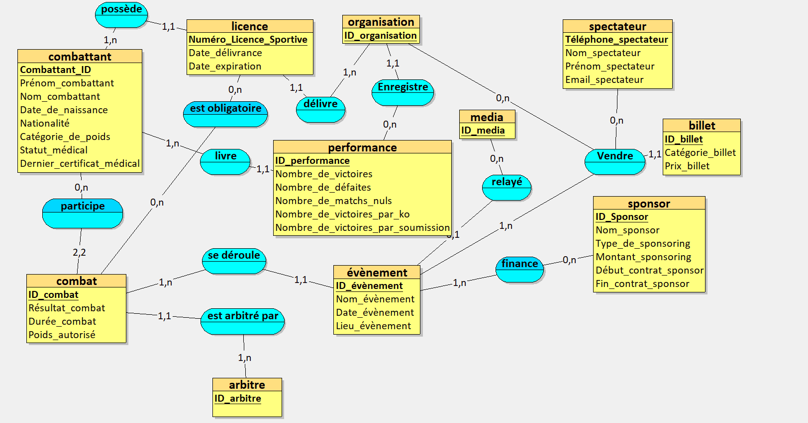
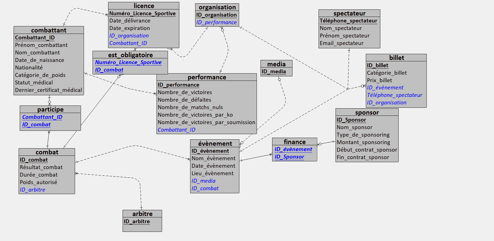

# Mini-Projet Bases de Données : Gestion d'une Organisation d'Événements de MMA

**Binôme :** Ayoub El Azzouzi et Chraf Eddine Guidouche

## 1. Contexte du projet

Ce projet a pour objectif de concevoir et développer une base de données relationnelle pour la gestion d'une organisation d'événements sportifs de MMA. Le système gère les combattants, leurs licences et performances, les combats, les arbitres, les événements, la billetterie, les spectateurs, les médias et le sponsoring.

## 2. Modèles de données

Le MLD a été déduit du MCD élaboré dans la Partie 1 en appliquant les règles de transformation MERISE.

### 2.1 Modèle conceptuel de données (MCD)



### 2.2 Modèle logique de données (MLD)



### 2.3 Description du MLD

Les clés primaires sont soulignées dans le diagramme. Dans la liste ci-dessous, `PK` désigne une clé primaire et `FK` une clé étrangère.

- **organisation** (`ID_organisation` PK, Nom_organisation, Email_organisation)
- **arbitre** (`ID_arbitre` PK, Nom_arbitre, Prénom_arbitre, Nationalité)
- **combattant** (`Combattant_ID` PK, Prénom_combattant, Nom_combattant, Date_de_naissance, Nationalité, Catégorie_de_poids, Statut_médical, Dernier_certificat_médical)
- **licence** (`Numéro_Licence_Sportive` PK, Date_délivrance, Date_expiration, `ID_organisation` FK, `Combattant_ID` FK)
- **performance** (`ID_performance` PK, Nombre_de_victoires, Nombre_de_défaites, Nombre_de_matchs_nuls, Nombre_de_victoires_par_ko, Nombre_de_victoires_par_soumission, `Combattant_ID` FK)
- **media** (`ID_media` PK, Nom_media, Type_media)
- **combat** (`ID_combat` PK, Résultat_combat, Durée_combat, Poids_autorisé, `ID_arbitre` FK)
- **évènement** (`ID_évènement` PK, Nom_évènement, Date_évènement, Lieu_évènement, `ID_media` FK, `ID_combat` FK, `ID_organisation` FK)
- **spectateur** (`Téléphone_spectateur` PK, Nom_spectateur, Prénom_spectateur, Email_spectateur)
- **billet** (`ID_billet` PK, Catégorie_billet, Prix_billet, `ID_évènement` FK, `Téléphone_spectateur` FK, `ID_organisation` FK)
- **sponsor** (`ID_Sponsor` PK, Nom_sponsor, Type_de_sponsoring, Montant_sponsoring, Début_contrat_sponsor, Fin_contrat_sponsor)
- **participe** (`Combattant_ID` PK et FK, `ID_combat` PK et FK)
- **est_obligatoire** (`Numéro_Licence_Sportive` PK et FK, `ID_combat` PK et FK)
- **finance** (`ID_évènement` PK et FK, `ID_Sponsor` PK et FK)

Les tables `participe`, `est_obligatoire` et `finance` représentent des associations plusieurs-à-plusieurs à l’aide de clés primaires composées.

## 3. Modèle physique de données (MPD)

Le MPD est implémenté en SQL dans la base `mma_event_db`.

### 3.1 Tables et contraintes d’intégrité

| Table | Clé primaire | Clés étrangères | Intégrité référentielle |
|---|---|---|---|
| `organisation` | `ID_organisation` | Aucune | — |
| `arbitre` | `ID_arbitre` | Aucune | — |
| `combattant` | `Combattant_ID` | Aucune | — |
| `licence` | `Numéro_Licence_Sportive` | `ID_organisation`, `Combattant_ID` | CASCADE / CASCADE |
| `performance` | `ID_performance` | `Combattant_ID` | CASCADE / CASCADE |
| `media` | `ID_media` | Aucune | — |
| `combat` | `ID_combat` | `ID_arbitre` | SET NULL / CASCADE |
| `évènement` | `ID_évènement` | `ID_media`, `ID_combat`, `ID_organisation` | SET NULL / CASCADE |
| `spectateur` | `Téléphone_spectateur` | Aucune | — |
| `billet` | `ID_billet` | `ID_évènement`, `Téléphone_spectateur`, `ID_organisation` | CASCADE / SET NULL |
| `sponsor` | `ID_Sponsor` | Aucune | — |
| `participe` | `Combattant_ID`, `ID_combat` | `Combattant_ID`, `ID_combat` | CASCADE / CASCADE |
| `est_obligatoire` | `Numéro_Licence_Sportive`, `ID_combat` | `Numéro_Licence_Sportive`, `ID_combat` | CASCADE / CASCADE |
| `finance` | `ID_évènement`, `ID_Sponsor` | `ID_évènement`, `ID_Sponsor` | CASCADE / CASCADE |

### 3.2 Fichiers SQL

Les scripts sont à exécuter dans cet ordre :

1. `1_creation.sql` — crée le schéma et les 14 tables avec leurs clés et règles d’intégrité.
2. `2_contraintes.sql` — ajoute les contraintes de validation métier, comme les règles sur le statut médical, le prix des billets et la cohérence des dates.
3. `3_insertion.sql` — insère le jeu de données de démonstration.
4. `4_interrogation.sql` — contient 20 requêtes d’exploitation SQL.

Les scripts utilisent la syntaxe MySQL. Vérifier que la base `mma_event_db` existe avant leur exécution. Le script de création peut supprimer des tables existantes : sauvegarder les données à conserver avant de le relancer.

## 4. Scénario d’utilisation

Le système est conçu pour être utilisé principalement par deux rôles :

1. **Le directeur sportif** analyse les performances des combattants, vérifie leur statut médical et leurs licences, prépare des affrontements selon les catégories de poids et désigne des arbitres.
2. **Le responsable financier et marketing** suit la vente des billets et les revenus par événement, évalue les partenariats avec les sponsors et organise les droits de diffusion avec les médias.

## 5. Étude d’optimisation d’une requête

### 5.1 Requête analysée — Q20

La requête recherche les noms, prénoms et nombres de victoires des combattants français ayant plus de 10 victoires et possédant une licence enregistrée.

```sql
SELECT c.Nom_combattant,
       c.Prénom_combattant,
       p.Nombre_de_victoires
FROM combattant AS c
JOIN performance AS p
  ON c.Combattant_ID = p.Combattant_ID
JOIN licence AS l
  ON c.Combattant_ID = l.Combattant_ID
WHERE c.Nationalité = 'France'
  AND p.Nombre_de_victoires > 10;
